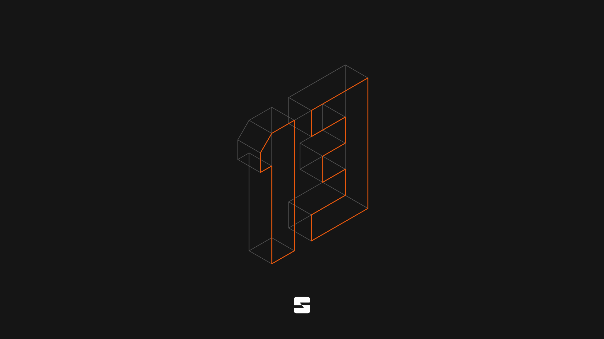

# From #news (`1558086129654169640`) in Altare (`1533809669900992562`)
**<DateDisplay timestamp="1791939412662" />**  
_matt james (mattjzmes, `1049816501567373383`)_
> @everyone
> 
> **Altare 13 Public Beta**
> 
> The current state of Altare 13's release is in order to test for bugs and issues before we launch the other 6 locations and our other product offerings. The economy, website, documentation and so on is fully functional and most of the platform is ready. This is one of the biggest changes to Altare in the last year, with a whole new design system, help center, documentation site, new console UI, several new features and drastically more capacity than Altare 12
> 
> Learn more about what's new at https://altare.gg/en/changelog
> 
> **All services are now available. After the beta period, no server data, credits or anything else will be reset.** Over the next 24 hours, everything here should return to normal with our bots being set up again, rewards being back and our social media will return to normal
> 
> 
> 

**<DateDisplay timestamp="1791939446437" />**  
_matt james (mattjzmes, `1049816501567373383`)_
> Console is available at https://console.altare.gg
> 

**<DateDisplay timestamp="1791939779691" />**  
_matt james (mattjzmes, `1049816501567373383`)_
> **Limitations during this period:**
> 
> Some paid services are not available including Altare One. Only Singapore is available right now
> 
> There may also be bugs, as such is the reason we are doing this public beta
> 

**<DateDisplay timestamp="1791981655624" />**  
_matt james (mattjzmes, `1049816501567373383`)_
> Some users were unable to make a server and got a generic unavailable message. This has been fixed and it should be possible now
> 

**<DateDisplay timestamp="1791991910627" />**  
_matt james (mattjzmes, `1049816501567373383`)_
> @everyone Besides a few bugs and exploits, all has gone well. Therefore we will begin scaling up our infrastructure and return Altare to normal operations
> 
> If anyone would like credits, feel free to invite your friends once again or help us do marketing. Altare 13 is here to stay, we have also started doing full offsite backups of all nodes, we commit to never losing server data
> 

**<DateDisplay timestamp="1791991982319" />**  
_matt james (mattjzmes, `1049816501567373383`)_
> It is unfortunate only 300 people are here vs our old 22k member Discord so it would be nice if you all could help invite people
> 
