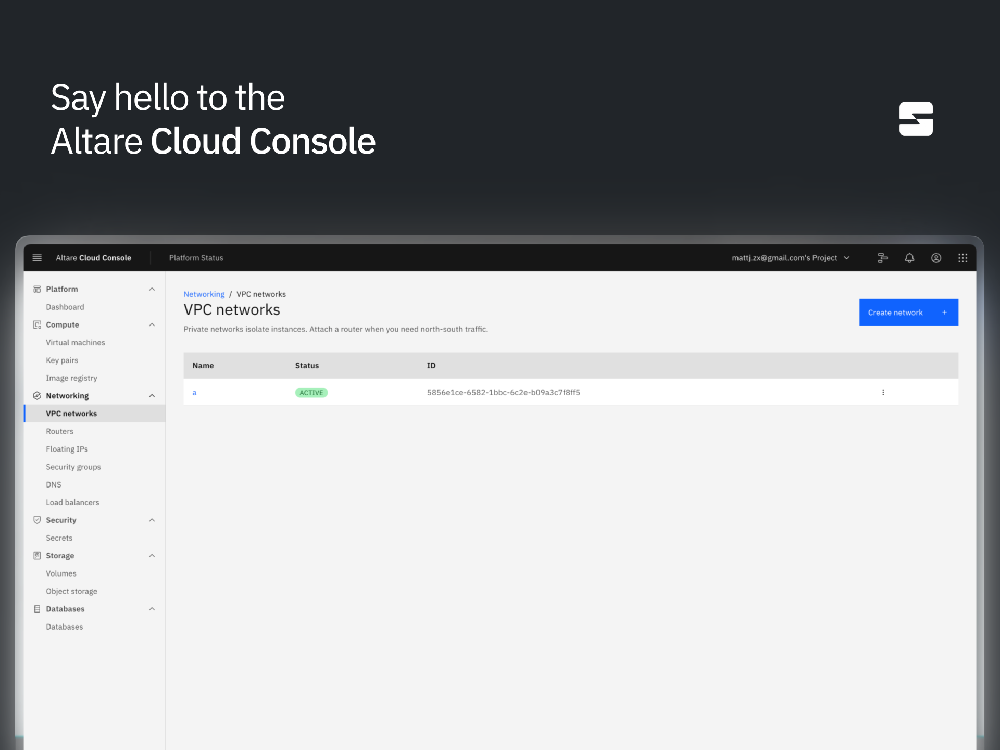
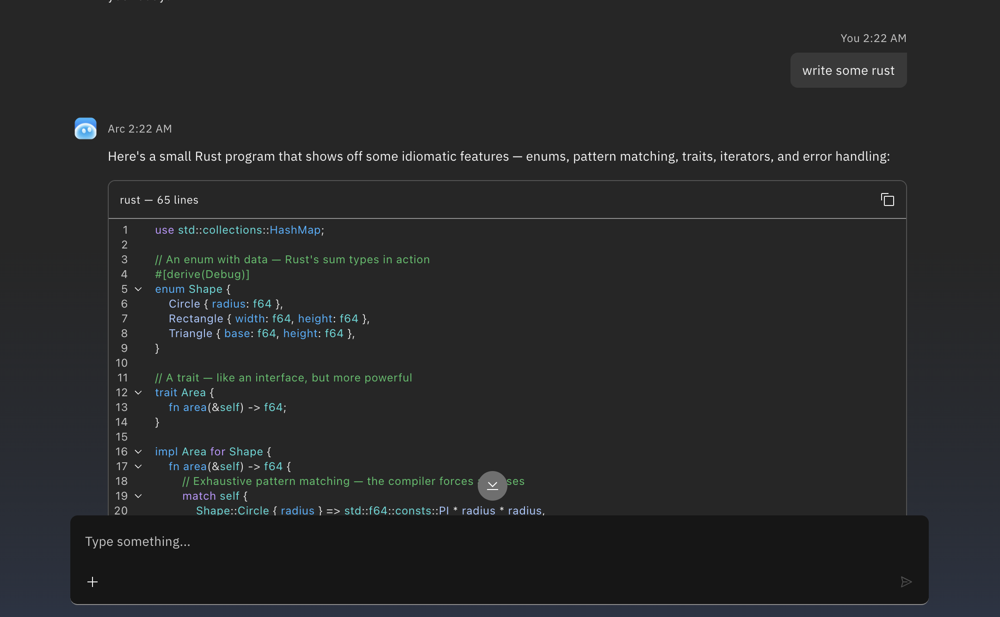
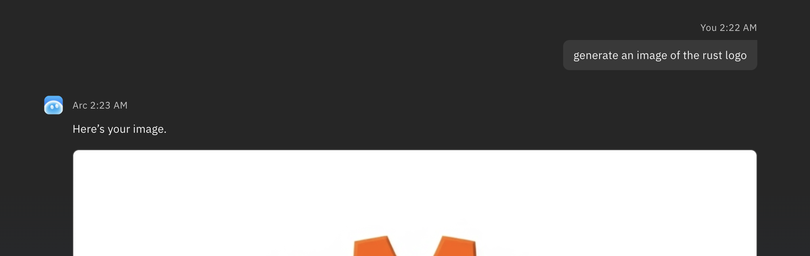

# From #news (`1544031281329995836`) in Altare (`1533809669900992562`)
**<DateDisplay timestamp="1788202764364" />**  
_matt james (mattjzmes, `1049816501567373383`)_
> @everyone Tomorrow, we introduce to you all Altare 13 (formerly Revenact)
> 
> You'll all be very happy I'm sure
> 

**<DateDisplay timestamp="1788202813957" />**  
_matt james (mattjzmes, `1049816501567373383`)_
> Once the Discord is all set up and back to normal we'll be professional
> 

**<DateDisplay timestamp="1788202877036" />**  
_matt james (mattjzmes, `1049816501567373383`)_
> I don't think Altare is dying this time
> 

**<DateDisplay timestamp="1788299021164" />**  
_matt james (mattjzmes, `1049816501567373383`)_
> @everyone hello people who wants to see?
> 

**<DateDisplay timestamp="1788299051769" />**  
_matt james (mattjzmes, `1049816501567373383`)_
> ill send some screenshots in the morning
> 

**<DateDisplay timestamp="1788299071883" />**  
_matt james (mattjzmes, `1049816501567373383`)_
> alright fine whoever reacted with that dm me
> 

**<DateDisplay timestamp="1788308667812" />**  
_matt james (mattjzmes, `1049816501567373383`)_
> 13
> 

**<DateDisplay timestamp="1788474014743" />**  
_matt james (mattjzmes, `1049816501567373383`)_
> @everyone As Altare 13 begins operations - from 4 Sept, all users of Altare Cloud (legacy) and what used to be Revenact (legacy) will be migrated to the Altare Cloud Console
> 
> It's the first platform that integrates our new brand and design system, using IBM's Carbon UI. We think it's very smooth and nice to use compared to earlier design systems and will be a great fit for Altare
> 
> --
> 
> We will have another announcement shortly for Arc and free hosting
> 
> 
> 

**<DateDisplay timestamp="1788571371228" />**  
_matt james (mattjzmes, `1049816501567373383`)_
> i promised you arc would exist one day
> 
> 
> 

**<DateDisplay timestamp="1788571395981" />**  
_matt james (mattjzmes, `1049816501567373383`)_
> 
> 

**<DateDisplay timestamp="1788734171546" />**  
_matt james (mattjzmes, `1049816501567373383`)_
> @everyone Altare 13 will begin operations on Sep 8
> 
> Altare Cloud is already operational. Our edge network is functioning alongside all Cloud products. Hosting will become available on the 8th with limited locations, full availability on the 13th. Altare Model Factory will be available on the 8th with Arc and Arc Code being available some time between the 8th and 13th
> 

**<DateDisplay timestamp="1788734207622" />**  
_matt james (mattjzmes, `1049816501567373383`)_
> Initially, Arc Code will be available completely for free with the same limits we plan to introduce on an Ultra tier plan in the future
> 

**<DateDisplay timestamp="1788734319547" />**  
_matt james (mattjzmes, `1049816501567373383`)_
> -
> 
> Similar to Meta, we will introduce a "contributor" version of Arc Magnus that is extremely cheap and uses far less of your limits. Usage may be used to train future Altare models, if you want no data retention or usage then you can use the normal models
> 
> **Benchmarks of Magnus 1.1:** Altare's Arc Magnus 1.1 model sits on the same point in most benchmarks as Opus/Fable and GPT 5.6 Sol. This is thanks to a significantly more advanced foundation model and more compute being available to us, alongside a new experiment to operate autonomous AI researchers which has turned out excellently for us. We have been trying to do this for a while due to the small size of Altare's team and it has turned out well
> 

**<DateDisplay timestamp="1788734414589" />**  
_matt james (mattjzmes, `1049816501567373383`)_

**<DateDisplay timestamp="1788750341427" />**  
_Patrick (tehopatrick, `905351880119549962`)_
> All made possible by me btw
> 

**<DateDisplay timestamp="1788877674994" />**  
_matt james (mattjzmes, `1049816501567373383`)_
> We are delaying it like a day or two because someone deployed all of the infrastructure except the nodes for Altare hosting
> 

**<DateDisplay timestamp="1788877691710" />**  
_matt james (mattjzmes, `1049816501567373383`)_
> We are blaming @Patrick (tehopatrick, `905351880119549962`) for this
> 

**<DateDisplay timestamp="1788917762692" />**  
_Patrick (tehopatrick, `905351880119549962`)_
> Hi
> 

**<DateDisplay timestamp="1788918594047" />**  
_Lirn (lirnn, `1230563250752458753`)_
> we have spent the last 11 hours blaming you
> 

**<DateDisplay timestamp="1788918687267" />**  
_Patrick (tehopatrick, `905351880119549962`)_
> D:
> 

**<DateDisplay timestamp="1788919023403" />**  
_matt james (mattjzmes, `1049816501567373383`)_
> it is clearly patrick's fault and not mine
> 

**<DateDisplay timestamp="1788919026077" />**  
_matt james (mattjzmes, `1049816501567373383`)_
> obviously
> 

**<DateDisplay timestamp="1789236692850" />**  
_matt james (mattjzmes, `1049816501567373383`)_
> the big 13 approaches
> 

**<DateDisplay timestamp="1789253720349" />**  
_matt james (mattjzmes, `1049816501567373383`)_
> @everyone Before the return of Altare, I'd just like to show the few people here something we have made (presumably in the future when we're back to 20k people will scroll up and see this)
> 
> Across the span of a week, using an internal version of an Arc Magnus model, we completely rewrote Docker in Rust. It's called Alchemy and performs dramatically better than Docker. It uses Youki internally instead of runc and works extremely well, it has close to 1:1 CLI and API compatibility and passes our very strict security and bug testing
> 
> Altare has began running it in production as a replacement for Docker. The same principle has been applied to other things Altare uses such as Pterodactyl, it has been rewritten in Rust and called Halogen and also works perfectly with Cryogenic (our existing Rust based daemon) and Alchemy
> 
> 
> 

**<DateDisplay timestamp="1789253769517" />**  
_matt james (mattjzmes, `1049816501567373383`)_
> At some point over the next month, we will make Alchemy, Halogen, Cryogenic all open source in case anyone would like to use it or at least have a dig through the codebase to confirm it's not AI slop
> 

**<DateDisplay timestamp="1789254020668" />**  
_matt james (mattjzmes, `1049816501567373383`)_
> alright fine keep your announcement
> 

**<DateDisplay timestamp="1789254033257" />**  
_matt james (mattjzmes, `1049816501567373383`)_
> if you get arrested for pedophilia its not my problem
> 

**<DateDisplay timestamp="1789254263297" />**  
_Patrick (tehopatrick, `905351880119549962`)_
> I am attracted exclusively to dead squirrels
> 

**<DateDisplay timestamp="1789254278337" />**  
_Patrick (tehopatrick, `905351880119549962`)_
> Although live ones are nice for the resistance sometimes
> 

**<DateDisplay timestamp="1789316291291" />**  
_Patrick (tehopatrick, `905351880119549962`)_
> https://cdn.discordapp.com/attachments/1514054891537039360/1548704090974978078/Video_Project_4.gif
> 

**<DateDisplay timestamp="1789411896027" />**  
_matt james (mattjzmes, `1049816501567373383`)_
> @here It has been delayed due to an attempted assassination of me
> 
