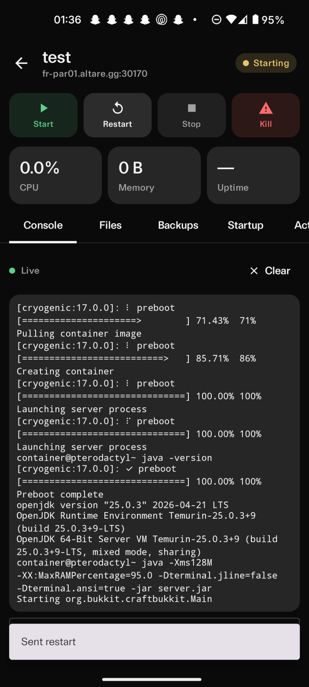
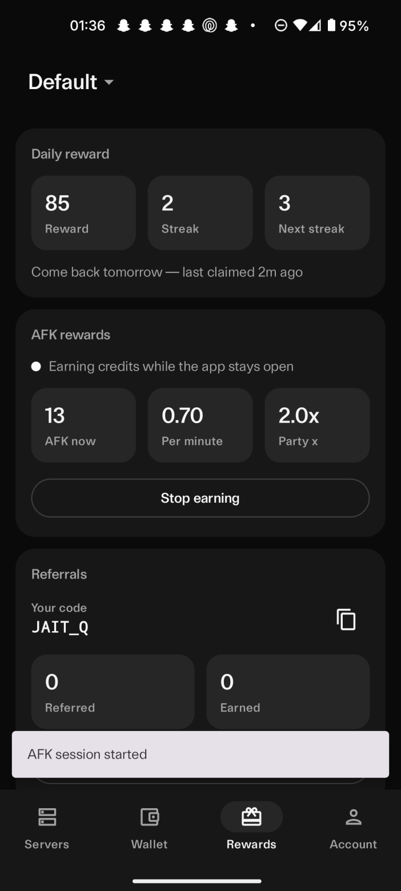
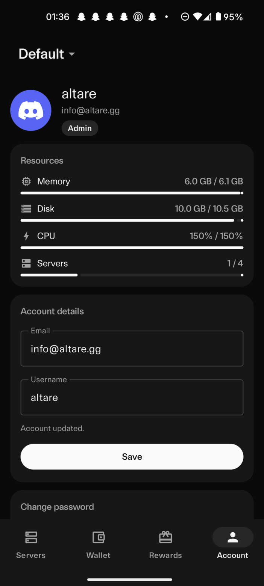
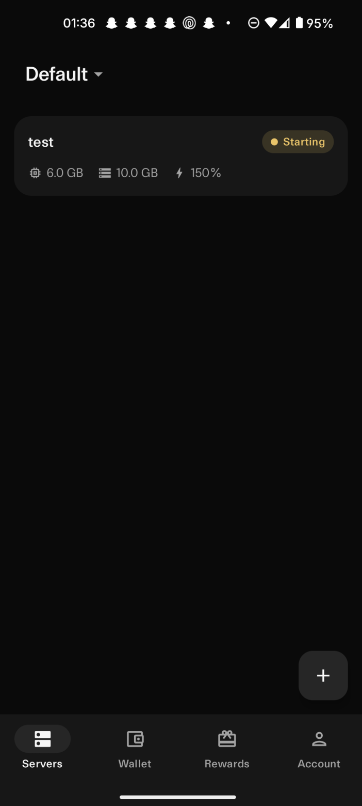
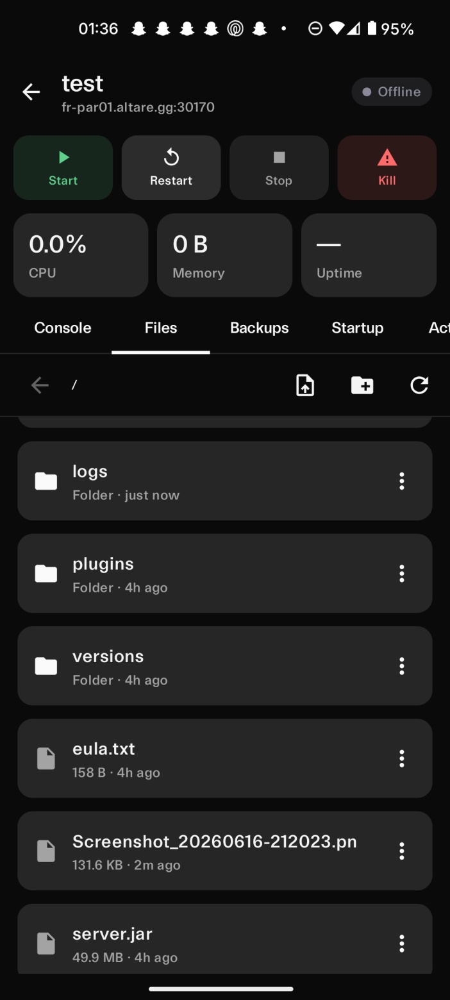

# From #news (`1506325344507007136`) in Altare (`841027661420691456`)
**<DateDisplay timestamp="1779206438163" />**  
_Altare (Altare, `1506321032678473740`)_
> my apologies for the incorrect channel for those webhooks
> 

**<DateDisplay timestamp="1779208659590" />**  
_o (d1stel, `845107582205165649`)_
> spooky scary skeletons
> 

**<DateDisplay timestamp="1780225492446" />**  
_altare (altare, `1510599724279922838`)_
> @everyone we're not dead. allow me a few hours and you'll all see
> 

**<DateDisplay timestamp="1780225522273" />**  
_altare (altare, `1510599724279922838`)_
> Console will temporarily be running the same one from Altare 10. But it will work
> 

**<DateDisplay timestamp="1780225549378" />**  
_altare (altare, `1510599724279922838`)_
> it doesn't matter anymore. A host working is better than nothing. It's not Altare 12 but it's something
> 

**<DateDisplay timestamp="1780225716024" />**  
_altare (altare, `1510599724279922838`)_
> everything will be set back up shortly
> 

**<DateDisplay timestamp="1780323976194" />**  
_sam (samm9400, `673662795077648424`)_
> top 10 lies of all time
> 

**<DateDisplay timestamp="1780323978284" />**  
_sam (samm9400, `673662795077648424`)_
> number 10
> 

**<DateDisplay timestamp="1780629027382" />**  
_nadhi (nothingwhere_wht2, `1411742194582421656`)_
> what takes more time? 
> 
> A) The amount of time needed to create another human being
> B) Altare
> 

**<DateDisplay timestamp="1780751467269" />**  
_altare (altare, `1510599724279922838`)_
> @everyone hello people i am back to work on altare today
> 

**<DateDisplay timestamp="1780751479363" />**  
_altare (altare, `1510599724279922838`)_
> i'm sure it will get delayed to 2045
> 

**<DateDisplay timestamp="1780751703647" />**  
_altare (altare, `1510599724279922838`)_
> the above was a joke but I doubt any of you will believe the host is coming so I'll show progress in general
> 

**<DateDisplay timestamp="1780751764233" />**  
_altare (altare, `1510599724279922838`)_
> also to the two individuals trying to exfiltrate money out of us that we don't owe: https://discord.com/channels/841027661420691456/1465562005455769671/1512806266706067651
> 

**<DateDisplay timestamp="1780778236704" />**  
_altare (altare, `1510599724279922838`)_
> @here half done with the first day working on altare again, here is the progress as it is unlikely anyone believes me
> 
> - panel is clustered and redundant, 6 clusters plus haproxy and galera. should be redundant across providers so if somehow altare's entire owned network packs in it will switch over with no outage. likely similar setup for console as heliactyl next is heliactyl next
> - pve and whatever for altare's owned infra was already up
> - nodes ordered and ready to be set up 
> 
> so what's left is setting up the console making a few changes and setting up the site and whatever else
> 

**<DateDisplay timestamp="1780827056477" />**  
_altare (altare, `1510599724279922838`)_
> I've made some changes to the panel source code to hopefully alleviate rate limiting and performance issues with Heliactyl
> 
> It's likely you'll all get Altare 10 again but without the disastrous performance
> 

**<DateDisplay timestamp="1780943286827" />**  
_altare (altare, `1510599724279922838`)_
> we are now at the stage where the console is being worked on
> 

**<DateDisplay timestamp="1781119003357" />**  
_altare (altare, `1510599724279922838`)_
> @everyone
> 
> We are holding a special event on 12 June 2026 at 12:00 BST. It will be streamed live from Altare's YouTube channel, as usual
> 
> -
> 
> In other news, Heliactyl Next 18 - the upcoming new software powering Altare's console is now available. It introduces a new more fluid, improved UI, a complete rewrite of Heliactyl's internals, dramatically better performance and patches several critical bugs and vulnerabilities. Interested in using it for your host? Please reach out to hello@altare.gg
> 
> 
> 

**<DateDisplay timestamp="1781119347310" />**  
_altare (altare, `1510599724279922838`)_
> *The new Arc Code is now in public beta*
> 
> Please react with :thumbsup: to be added to the waitlist. You will receive a DM from the Altare bot if you are selected for testing
> 
> Arc Code now has workflows, is built for significantly longer horizon tasks and now supports the latest Arc Magnus and Arc Colossus models from Altare AI
> 
> Temporarily, it will not ask you to sign in with the Altare Console. In a few days, it will require that
> 
> 
> 

**<DateDisplay timestamp="1781255053408" />**  
_altare (altare, `1510599724279922838`)_
> @everyone I've accidentally lost the video for the event today so we'll either just release Altare 12 without or it I'll make a new one quickly. Apologies
> 

**<DateDisplay timestamp="1781255102498" />**  
_altare (altare, `1510599724279922838`)_
> Everything is still on time
> 

**<DateDisplay timestamp="1781261558887" />**  
_altare (altare, `1510599724279922838`)_
> The console is currently up right now but it's disabled as we're trying to fix some network issues
> 

**<DateDisplay timestamp="1781264660023" />**  
_altare (altare, `1510599724279922838`)_
> We have submitted Altare's new mobile app (only Android to begin with, as that's what most people here use) to the Play Store for review
> 

**<DateDisplay timestamp="1781345356103" />**  
_altare (altare, `1510599724279922838`)_
> @everyone We have held back the release as Altare's network is switching to Lumen to fix stability issues
> 
> If we haven't mentioned it before:
> Altare no longer relies on other providers and uses our own infrastructure and network for better control. You will all notice this, as all of our IPs show "Altare, Inc." as the ISP. In the long term, this will result in a much better experience for everyone as we have faced problem after problem with cloud providers, and that's alleviated by using our own infrastructure
> 

**<DateDisplay timestamp="1781345365934" />**  
_altare (altare, `1510599724279922838`)_
> The current ETA is today
> 

**<DateDisplay timestamp="1781345432542" />**  
_altare (altare, `1510599724279922838`)_
> Please keep in mind that **we did not have a choice here**. Consistent issues with our current upstream would seriously impact users trying to use the new Altare. We do not want a repeat of any of the previous two releases, we want a smooth release of Altare 12
> 

**<DateDisplay timestamp="1781434978177" />**  
_altare (altare, `1510599724279922838`)_
> @here Work on Altare's infrastructure has finished. Progress will now continue and Altare 12 will release imminently. It is certainly better than before: https://www.speedtest.net/result/c/fa63ecfe-d97f-4e51-80f6-5cc15b6d2a9f
> 

**<DateDisplay timestamp="1781443656116" />**  
_altare (altare, `1510599724279922838`)_
> 
> 

**<DateDisplay timestamp="1781636636842" />**  
_Altare (Altare, `1510599724279922838`)_
> @everyone Twelve.
> 
> https://altare.gg
> 
> 
> 

**<DateDisplay timestamp="1781636839106" />**  
_Altare (Altare, `1510599724279922838`)_
> All 51 nodes are ready and online. Rewards will be available to be claimed tonight via tickets as usual
> 

**<DateDisplay timestamp="1781641876113" />**  
_nadhi (nothingwhere_wht2, `1411742194582421656`)_
> Altare 121?
> 

**<DateDisplay timestamp="1781656745962" />**  
_Altare (Altare, `1510599724279922838`)_
> @everyone If anyone wants access to the Altare Android app please DM your Google email to @Ether (ethdr, `258262924986941440`)
> 
> It is ready but in order to be published on Google Play it must be "tested" for 14 days
> 
> 
> 
> 
> 
> 
> 

**<DateDisplay timestamp="1781657221292" />**  
_Altare (Altare, `1510599724279922838`)_
> :warning: Currently a bug with the app with creating servers. Will be fixed with the next release
> 

**<DateDisplay timestamp="1781667565368" />**  
_Lirn (lirnn, `1230563250752458753`)_
> Creating, sharing, or using tools designed to abuse Altare services will result in a ban from Altare services. This is a warning
> 

**<DateDisplay timestamp="1781691068230" />**  
_Erlich Bachman (altaregg, `1024300865949024387`)_
> Please note that many services are **not** allowed on Altare:
> - Tor or any form of proxy
> - Cryptocurrency miners
> - Anything illegal in our jurisdiction 
> - Code that would be considered malicious, ex. scrapers
> - WhatsApp bots (unfortunately due to spam)
> 
> Shell servers may be falsely flagged. You will need to open a ticket and explain what your use case is in order to be manually unsuspended
> 

**<DateDisplay timestamp="1781692692107" />**  
_Altare (Altare, `1510599724279922838`)_
> We are deploying new nodes
> 

**<DateDisplay timestamp="1781694629569" />**  
_Altare (Altare, `1510599724279922838`)_
> The following nodes have been provisioned:
> ```
> au-syd03, au-syd04, br-gru05, br-gru06, br-gru07, br-gru08, ca-yul03, ca-yul04, de-fra05, de-fra06, de-fra07, de-fra08, fr-par02, gb-lon05, gb-lon06, gb-lon07, gb-lon08, ie-dub03, ie-dub04, in-bom05, in-bom06, in-bom07, in-bom08, in-bom09, in-bom10, in-bom11, in-bom12, in-bom13, in-bom14, in-bom15, in-bom16, in-bom17, in-bom18, jp-kix02, jp-tyo05, jp-tyo06, jp-tyo07, jp-tyo08, kr-icn05, kr-icn06, kr-icn07, kr-icn08, se-arn02, sg-sgp07, sg-sgp08, sg-sgp09, sg-sgp10, sg-sgp11, sg-sgp12, sg-sgp13, sg-sgp14, sg-sgp15, sg-sgp16, sg-sgp17, sg-sgp18, sg-sgp19, sg-sgp20, sg-sgp21, sg-sgp22, sg-sgp23, sg-sgp24, sg-sgp25, sg-sgp26, sg-sgp27, sg-sgp28, sg-sgp29, sg-sgp30, us-cmh02, us-iad05, us-iad06, us-iad07, us-iad08, us-pdx05, us-pdx06, us-pdx07, us-pdx08, us-sjc03, us-sjc04```
> 
> Currently 128 nodes are available and 17 locations
> 

**<DateDisplay timestamp="1781698813085" />**  
_Altare (Altare, `1510599724279922838`)_
> Due to abuse, credit transfers have been disabled
> 
> At this time, we are not accepting manual approval. This may change within the next few hours (or tomorrow)
> 

**<DateDisplay timestamp="1781715783199" />**  
_Altare (Altare, `1510599724279922838`)_
> @everyone There are widespread issues with our Cryogenic software causing all of the nodes to crash. We are working on it
> 

**<DateDisplay timestamp="1781720741328" />**  
_Lirn (lirnn, `1230563250752458753`)_
> You no longer need to open a ticket to claim rewards
> Go to the #rewards (`1466142547461017876`) channel and click **Your Rewards** to check what you can claim or use the ``/rewards`` command. Before claiming make sure your Altare wallet handle ID is set here:
> https://altare.gg/billing/credits/settings
> 
> Tickets should now only be opened for support issues, not reward claims
> 

**<DateDisplay timestamp="1782331545763" />**  
_Erlich Bachman (altaregg, `1024300865949024387`)_
> @everyone I apologise for the lack of updates and no clear reason as to why Altare is gone again
> 
> We will be back very soon. Due to issues with our upstreams and infrastructure providers, we have had difficulty keeping nodes stable and have kept things off to prevent instability for users. This will change very soon
> 

**<DateDisplay timestamp="1782331575525" />**  
_Erlich Bachman (altaregg, `1024300865949024387`)_
> Once this is resolved, we anticipate (at minimum) months of stable service
> 

**<DateDisplay timestamp="1782331656380" />**  
_Erlich Bachman (altaregg, `1024300865949024387`)_
> We would like to raise money and in the future a Series A, and  to do this we need to make sure people are happy with Altare and our platform works perfectly 
> 
> We have also achieved this, the last problem is the nodes. Our console issues are gone
> 

**<DateDisplay timestamp="1782331888714" />**  
_Erlich Bachman (altaregg, `1024300865949024387`)_
> —
> 
> Either way, we will give everyone 1500 credits to try Altare again when things are stable. And if something goes wrong for some reason, we’ll give everyone even more. We are confident
> 

**<DateDisplay timestamp="1782332458504" />**  
_nadhi (nothingwhere_wht2, `1411742194582421656`)_
> two problems in one solution ahh
> 
